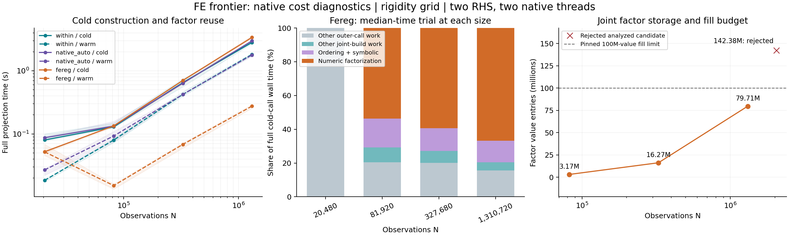

# Native solver cost diagnosis — 2026-10-29

## Finding

The apparent seven-step regime in fereg is now directly identified as an
adaptive move to a joint sparse factor. At 1,310,720 observations, building that
factor accounts for a median **83.78% of the first complete projection's wall
time**. Reusing it is fast, but this regime ends at a concrete storage-policy
boundary: at 2,048,000 observations, symbolic analysis requests 142,379,817
factor-value slots, exceeding the pinned core's 100,000,000-slot budget. The
joint factor is rejected before numerical factorization. The solver still
passes the independent accuracy check, using a different preconditioner path
and many more operator applications.

Within and native auto also keep low iteration counts by doing substantial
preconditioner work. Their three local factor dimensions grow from 2,048 to
131,072 over the main experiment. A nearly constant counter is therefore not
evidence of nearly constant total work.

These are observations on the existing `rigidity_grid` family and pinned
research builds. They establish a mechanism and a route boundary; they do not
establish a universal complexity bound, a lower bound, or a violation of a
near-quadratic upper bound. The original v0.1 results remain unchanged.

The middle panel partitions the wall time of one actual median-time trial at
each size. The other panels show medians and min–max ranges where repeated.
The red cross is an **analyzed, rejected candidate**, not allocated factor
storage. [SVG](results/2026-10-29/cost_scaling.svg) is available for export.

## Evidence and experiment contract

| Evidence | Contents |
|---|---|
| [Main raw observations](results/2026-10-29/rigidity_cost_study.json.gz) | 72 fresh workers, 144 complete projections; all passed |
| [Main tables](results/2026-10-29/rigidity_summary.md) / [structured summary](results/2026-10-29/rigidity_summary.json) | All 48 configuration/call groups, counts, timings, paired ratios, repeat checks |
| [Budget raw observations](results/2026-10-29/fereg_budget_probe.json.gz) | One additional worker, two projections; both passed |
| [Budget tables](results/2026-10-29/fereg_budget_summary.md) / [structured summary](results/2026-10-29/fereg_budget_summary.json) | Explicitly single-trial exploratory evidence |
| [Build identities](results/2026-10-29/build_provenance.json) / [prepared source manifest](results/2026-10-29/prepared_source_manifest.json) | Source archives, patches, locks, toolchain, wheels, loaded extensions |
| [Validation record](results/2026-10-29/validation.json) / [checksums](results/2026-10-29/SHA256SUMS) | Executed checks and artifact identities |

The main experiment uses grid sides 32, 64, 128 and 256; three backends; both
diagnostics-on and diagnostics-off settings of the same patched binaries; three
fresh-process repeats; and a cold call followed by a second call on the same
solver. Each call has two RHS and two native threads. The fixture uses unit
weights, broadband targets and seed `20261029`. Requested tolerance is
`1e-10`, the iteration budget is 2,000, and the worker deadline is 180 seconds.

The external accuracy condition is

\[
\|\widehat r-r_*\|_W/\|y\|_W \le 2\times10^{-8}.
\]

The largest measured error in the main experiment is
`5.026528489640017e-12`. The fixture's independent witnesses check that the
supplied residual is weighted-group orthogonal and that the fitted component
is generated by categorical coefficients. Small integration cases additionally
use a separately assembled dense SVD. Large-case checks use floating-point
witnesses, not interval-certified exact arithmetic.

The measured cold time includes input/layout work, fresh solver construction,
deferred native construction, the full projection and output recovery. The
warm call uses the same solver, RHS and weights; it supplies no initial
coefficient seed and does not return a cached projection. Imports, fixture
generation, external validation and optional diagnostic getter processing are
outside that clock. Wrapper certification and corrective projection remain
inside it. See the [accounting contract](README.md#data-contract-and-accounting).

The machine reports an AMD EPYC 9V74, Linux x86-64 with glibc 2.39, an 8 GiB
cgroup memory limit and eight CPU equivalents of quota. This is one shared
execution environment. All builds and test jobs were stopped before formal
timing. Three repetitions characterize the recorded variability; they do not
supply hardware-independent performance guarantees.

## 1. Complete projection times

Diagnostics-on medians of three repetitions, in seconds:

| Grid side | Observations N | within cold / warm | native auto cold / warm | fereg cold / warm |
|---:|---:|---:|---:|---:|
| 32 | 20,480 | 0.080213 / 0.018415 | 0.087082 / 0.026955 | 0.052139 / 0.052005 |
| 64 | 81,920 | 0.129400 / 0.080002 | 0.133415 / 0.092669 | 0.134243 / 0.015206 |
| 128 | 327,680 | 0.649263 / 0.422343 | 0.636338 / 0.422997 | 0.703397 / 0.068283 |
| 256 | 1,310,720 | 2.809604 / 1.818574 | 2.976105 / 1.781361 | 3.377146 / 0.275424 |

At side 256, the min–max cold ranges are 2.688–2.874 s for within,
2.900–3.029 s for native auto, and 3.316–3.604 s for fereg. Corresponding
warm ranges are 1.746–1.885 s, 1.686–1.795 s, and 0.256–0.291 s. Thus the
substantial fereg reuse advantage is visible in these trials, while close
first-call rankings should not be generalized.

The family grows rank as well as observations: `N=20*side**2`,
`G=6*side**2`, and the categorical normal matrix has rank `G-2`.
Its spectral promise and construction are documented in
[FAMILY_DESIGN.md](../FAMILY_DESIGN.md). This remains a structured subclass
of the broader high-dimensional FE problem.

## 2. What fereg's seven steps actually cost

For sides 64, 128 and 256, cold calls have `exact=true`, `escalated=true`,
`precond_kinds=["joint"]`, one joint factor build, seven actual reduced-Schur
matvec batches, eight preconditioner batches and one exact preconditioner
application. The pinned PCG path and instrumentation identify six ordinary
PCG steps, the residual matvec at adaptive restart, and the exact-factor
correction. Assembly and factorization are outside the integer iteration
counter, but remain inside elapsed projection time.

The wrapper reports `[7, 7]` because it copies one shared lockstep count to
both RHS. It is not fourteen independent iterations. Actual matvec counters
refer to the compressed-cell reduced Schur operator on the full RHS batch,
not a scan of the original rectangular design. Batch-width counters separately
record fourteen RHS columns for seven two-column applications, including any
frozen columns.

| Grid side | Cold matvec / precond batches | Warm matvec / precond batches | Allocated joint factor values | Assembled full-CSR nnz |
|---:|---:|---:|---:|---:|
| 32 | 139 / 140 | 139 / 140 | No joint factor | No joint candidate |
| 64 | 7 / 8 | 0 / 1 | 3,168,311 | 507,904 |
| 128 | 7 / 8 | 0 / 1 | 16,270,722 | 2,031,616 |
| 256 | 7 / 8 | 0 / 1 | 79,707,216 | 8,126,464 |

The side-32 case follows the small-block policy and does not build a joint
factor. At larger main sizes, warm calls reuse the factor without rebuilding:
one exact application and zero core matvecs. They still perform RHS assembly,
recovery, wrapper work and output copying.

| Grid side | Joint build median s | Analysis median s | Initial numeric factor median s | Median per-trial build / total |
|---:|---:|---:|---:|---:|
| 64 | 0.102887 | 0.022858 | 0.067617 | 75.87% |
| 128 | 0.561937 | 0.094206 | 0.418016 | 79.89% |
| 256 | 2.852785 | 0.433683 | 2.253025 | 83.78% |

The last column is the median of each trial's ratio, not the ratio of two
medians. At side 256 its three values span 83.08–84.47%. Analysis includes
lower-triangle extraction, ordering/AMD and symbolic analysis. Numeric time
is initial numerical factorization. These stages are nested inside joint
build, which is nested inside the solve; adding all columns double-counts.

`factor entries` means allocated `len_val`, including possible supernodal
padding. It is not an exact count of nonzero values in the mathematical
factor. At side 256 the values alone occupy 637,657,728 bytes, about 608.12
MiB at eight bytes per value. Indices, symbolic state, workspaces and all other
solver/data memory are additional. This is not peak RSS.

## 3. A budget boundary at side 320

The side-256 factor is already near the core's fixed `MAX_JOINT_LEN =
100_000_000` gate. A single follow-up trial at side 320 tests the route after
crossing it. This is an exploratory mechanism check, not a fourth repeated
timing series.

| Diagnostic | Side 256, main experiment | Side 320, one trial |
|---|---:|---:|
| Observations | 1,310,720 | 2,048,000 |
| Analyzed joint factor values | 79,707,216 | 142,379,817 |
| Joint factor actually present | Yes | No |
| Joint build outcome | `built` | `over the fill budget` |
| Joint numerical factor calls, cold | 1 | 0 |
| Cold shared iterations | 7 | 69 |
| Cold matvec / precond batches | 7 / 8 | 70 / 71 |
| Warm shared iterations | 1 | 58 |
| Warm matvec / precond batches | 0 / 1 | 58 / 59 |
| Cold total seconds | 3.377146 median | 8.345950 |
| Warm total seconds | 0.275424 median | 6.073912 |

At side 320, `joint_analyzed_factor_entries=142379817`, while
`joint_factor_entries=null`. The large candidate was analyzed and rejected;
142 million joint values were **not allocated**. The attempted build still
costs 1.057848 s, including 0.223474 s assembly and 0.761728 s analysis. There
is no joint numerical factorization. The actual preconditioners become
`["approx-chol", "sparse-chol"]`, with one large-block escalation in the cold
call. The retained exact large-block factor contains 22,365,678 values; the
approximate factor's storage is unavailable, so this is not total factor memory.

The warm call retains those block preconditioners but has no joint factor to
reuse. Its 59 preconditioner applications cost 4.895496 s, about 80.60% of its
6.073912 s outer time. Both calls pass the independent forward-error gate;
their errors are `5.576735790579497e-13` and `4.334741721025503e-13`.

This supplies direct evidence of a policy-dependent route discontinuity.
The observation count increases by 1.5625 times, while this one trial's warm
time is 22.05 times the side-256 median. That ratio describes the recorded
comparison; it is not a scaling exponent or a reproducible estimate from
multiple side-320 trials. Fitting one power law across the policy switch would
mix different algorithms and setup/reuse regimes.

The gate and its order relative to factorization are visible in the pinned
[fereg source](https://github.com/leoliu0/fereg/blob/0fa59e3b539addbddaee8bd71acd031c497166a0/crates/fereg-core/src/solve.rs)
and the archived [instrumentation patch](patches/fereg.patch).

## 4. Within and native auto's hidden construction work

All main sizes upgrade to additive Schwarz. Each cold call has one deferred
build; reused calls have zero additional deferred builds. There are three
local factors, each with solve dimension 2,048, 8,192, 32,768 or 131,072 as
the grid side grows. These are growing operators even where iteration counts
change little.

At side 256, actual vector-call counts are:

| Backend / call | Design apply | Design adjoint | Preconditioner apply | Preconditioner adjoint |
|---|---:|---:|---:|---:|
| within cold | 92 | 98 | 94 | 0 |
| within warm | 76 | 80 | 76 | 0 |
| native auto cold | 73 | 76 | 74 | 0 |
| native auto warm | 66 | 68 | 66 | 0 |

These totals sum actual vector calls across RHS and any wrapper corrective
projections. Within's cold two-column request makes two batch solves, so its
core `rhs_columns=4` does not mean four user RHS. Native auto solves its two
columns sequentially. The different wrapper paths must remain explicit when
comparing counts.

Median deferred build time at side 256 is 0.688789 s for within and
0.796388 s for native auto. The local-factor dimension histogram also records
one cross-tab with 524,288 nonzeros and two with 655,360. Cross-tab nonzeros
are not factor nonzeros. Within's approximate factor storage, symbolic/numeric
split and actual arithmetic work are still unavailable. Its parallel RHS
operator timers may overlap; their sum cannot partition wall time.

## 5. Instrumentation overhead and validation limits

Diagnostics on/off uses the same patched binaries in separate fresh workers,
with order reversed on alternating repetitions. The toggle disables hot-loop
counters and timers. Both sides still contain research wrapper logic,
metadata, snapshots and coarse construction timing. This is not a comparison
between the complete patch and the original wheel.

At side 256, paired on/off time ratios are:

| Backend | Cold median [min, max] | Warm median [min, max] |
|---|---:|---:|
| within | 0.9673 [0.9585, 0.9914] | 1.0057 [0.9894, 1.0578] |
| native auto | 1.0982 [1.0680, 1.0997] | 1.0156 [0.9498, 1.0189] |
| fereg | 0.9384 [0.8614, 0.9767] | 0.9896 [0.9807, 1.0783] |

Ratios are formed within each replicate before taking medians. Across all
sizes, individual ratios span 0.6034–1.4804. Values below one are evidence of
measurement variability, not evidence that counters intrinsically accelerate
the solver. Three repeats cannot identify a universal small overhead.

The 96-test frontier suite passes with the final diagnostic wheels and no
skips. Nine tests require actual native integrations and compare weighted
dense SVD references, permutations, reuse and failure recovery. Four targeted
fereg Rust tests pass, including bitwise diagnostic on/off parity, exact-path
zero-matvec accounting, restart work and weight-refresh/failure accounting.
The [validation record](results/2026-10-29/validation.json) separately records
repository gates and any environment failures; it is not inferred from the
benchmark success flags.

The final local full repository suite reports **507 passed, one failed**.
The remaining failure is the previously observed fresh-process workqueue
test: the child raises `psutil.NoSuchProcess` while querying its own RSS.
That test passes alone in this checkout. Its context-dependent cause remains
unresolved, so the local full suite is not reported as green. The version,
generated architecture and diff-whitespace gates pass. The initial full-suite
attempt that overlapped compilation and stale generated maps is also retained
as a failed attempt in the validation record.

An earlier small study printed eight calls but a later aggregate read showed
four, while all four worker files were complete. Its cause was not established.
The runner now explicitly writes and rereads the full final report, verifies
content equality and prints its SHA256. The formal 144-call and two-call
archives were additionally compared against every worker result, independently
reread, and losslessly compressed. No missing call was silently discarded.

## Interpretation and next measurement target

The main question is now better specified: how do setup, factor storage,
operator application and reuse behave on each actual solver route? Fereg's
seven-step region is a factor-construction-and-reuse regime with a finite
fill budget. Within's small counters accompany growing local factors.
Neither result alone establishes universal near-linear work, and good
performance on a family is fully compatible with a larger worst-case upper
bound. The budget threshold is an implementation policy, not an information
theoretic lower bound.

The next missing internal measurement is within's approximate-factor storage
and its construction/application work. A useful follow-up would also repeat
several sizes around fereg's route boundary with explicit storage budgets and
multiple distinct RHS, separating amortized reuse from one-call cost. Weight
refresh counters exist and have targeted correctness tests, but this fixed-
weight study makes no IRLS performance claim. Those are further experiments,
not conclusions silently extrapolated from the present data.
